  

  
  
  

  I build retrieval and LLM systems that run in production, and I like fixing what makes them slow or wrong.

---

## ⚡ What I do now

Founding full-stack AI engineer at **COROS AI** since April 2025. I designed and built the AI platform from scratch as a set of services, and own features from system design to deployment.

  

- **Faster retrieval:** reworked semantic search and retrieval in our RAG system to get the numbers above.
- **Memory that stays on topic:** a semantic memory layer with topic-isolated user spaces and time-based decay, so context from one topic does not leak into another.
- **Answers you can trust:** automated evals with relevance scoring, and HyDE-based retrieval to cut hallucinations.

## 🚀 Projects

| | Project | What it is |
|---|---|---|
| 📚 | [**NextBook**](https://github.com/maazrehman99/NextBook) · [live](https://next-book-pearl.vercel.app) | Book recommendation system with a retrieval-augmented LLM pipeline. Deployed at Abul Kalam University Library, 200+ users, about 50% faculty adoption. |
| 🎯 | [**PinpointAI**](https://github.com/maazrehman99/PinpointAI) · [live](https://pinpoint-ai.vercel.app) | Turns meeting transcripts (VTT or DOCX) into editable action items, with PDF export. Next.js, Express, OpenAI API. |

## 🧰 Stack

  
  
  
  
  
  

  
  
  
  
  

  
  
  
  

  
  
  
  

## 🎓 Elsewhere

BS in Computer Science (AI and ML), NED University, expected 2027. Winner of the Data Insights Hackathon.

  <i>If you have a retrieval or LLM system that is slow, wrong, or hard to trust, I am happy to talk.</i>

